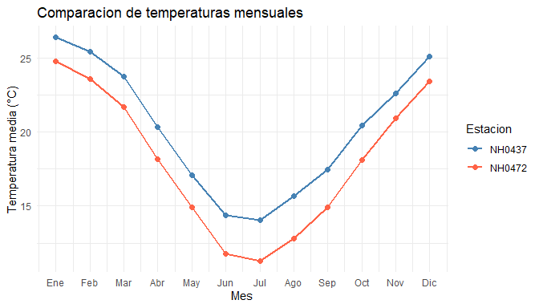

# meteodata

<!-- badges: start -->

<!-- badges: end -->

Paquete de R desarrollado para Programación II que permite leer, resumir
y visualizar datos meteorológicos de estaciones del INTA.

## Autores

- Santiago Jauregui
- Mateo Garcia

## Instalación

Instalá el paquete desde GitHub:

``` r
install.packages("remotes")
remotes::install_github("Santiago-Jauregui7/meteodata")
```

## Datos incluidos

El dataset `estaciones` contiene 95.681 observaciones y 35 columnas.
Reúne datos diarios de cinco estaciones: NH0472, NH0910, NH0046, NH0098
y NH0437.

``` r
library(meteodata)

dim(estaciones)
#> [1] 95681    35

unique(estaciones$id)
#> [1] "NH0472" "NH0910" "NH0046" "NH0098" "NH0437"

head(
  estaciones[
    c("id", "fecha", "temperatura_abrigo_150cm")
  ]
)
#>       id      fecha temperatura_abrigo_150cm
#> 1 NH0472 1961-07-01                     11.1
#> 2 NH0472 1961-07-02                      5.5
#> 3 NH0472 1961-07-03                      6.0
#> 4 NH0472 1961-07-04                       NA
#> 5 NH0472 1961-07-05                     12.4
#> 6 NH0472 1961-07-06                     11.0
```

La columna `id` identifica la estación y `fecha` indica el día de la
observación. La temperatura de abrigo a 150 cm está expresada en grados
Celsius.

Los datos provienen del [repositorio del
curso](https://github.com/rse-r/intro-programacion/tree/main/datos).

## Leer datos de una estación

`leer_datos()` recibe el identificador de una estación y la ruta de un
archivo CSV. Si el archivo existe, lo lee directamente. Si todavía no
existe, intenta descargarlo y guardarlo.

Este ejemplo requiere conexión a Internet:

``` r
datos <- leer_datos(
  id = "NH0437",
  ruta = "datos/NH0437.csv"
)

head(datos)
```

## Resumir temperaturas

`tabla_resumen_temperatura()` calcula la temperatura mínima, máxima,
promedio y el desvío estándar de cada estación.

``` r
tabla_resumen_temperatura(estaciones)
#> # A tibble: 5 × 5
#>   id     minima maxima promedio desvio
#>   <chr>   <dbl>  <dbl>    <dbl>  <dbl>
#> 1 NH0472   0.55   34.8     18.0   5.94
#> 2 NH0910   0      35.2     17.7   6.12
#> 3 NH0046  -0.25   34.6     17.3   5.90
#> 4 NH0098 -17.4    37.4     18.6   5.98
#> 5 NH0437   2.1    36.3     20.2   5.77
```

El argumento `ids` permite seleccionar una o varias estaciones:

``` r
tabla_resumen_temperatura(
  estaciones,
  ids = c("NH0437", "NH0472")
)
#> # A tibble: 2 × 5
#>   id     minima maxima promedio desvio
#>   <chr>   <dbl>  <dbl>    <dbl>  <dbl>
#> 1 NH0437   2.1    36.3     20.2   5.77
#> 2 NH0472   0.55   34.8     18.0   5.94
```

Los valores faltantes se excluyen de los cálculos. Si una estación no
tiene temperaturas válidas, sus estadísticas se muestran como NA.

## Graficar temperaturas mensuales

`grafico_temperatura_mensual()` calcula y grafica la temperatura
promedio de cada mes del calendario para cada estación. Reúne las
observaciones del mismo mes de los distintos años.

Podemos seleccionar estaciones y personalizar los colores y el título:

``` r
seleccion <- estaciones[
  estaciones$id %in% c("NH0437", "NH0472"),
]

grafico_temperatura_mensual(
  seleccion,
  colores = c(
    NH0437 = "steelblue",
    NH0472 = "tomato"
  ),
  titulo = "Comparacion de temperaturas mensuales"
)
```



## Documentación

Consultá la [guía de
uso](https://github.com/Santiago-Jauregui7/meteodata/blob/main/vignettes/uso_de_meteodata.Rmd)
para encontrar más explicaciones y ejemplos.

También podés consultar la ayuda de las funciones desde R:

``` r
?leer_datos
?tabla_resumen_temperatura
?grafico_temperatura_mensual
```

## Licencia

El código del paquete se distribuye bajo licencia MIT. Consultá el
archivo [LICENSE.md](LICENSE.md).
