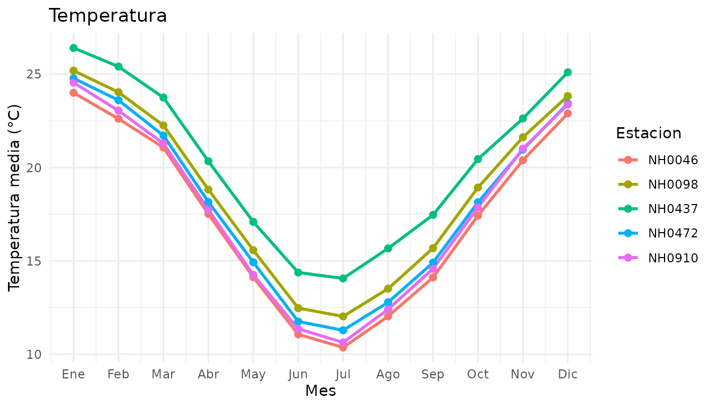
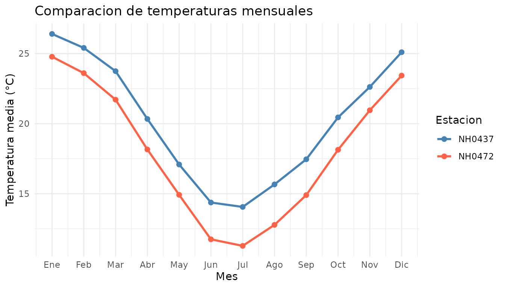

# Uso de meteodata

## Introducción

meteodata permite leer, resumir y graficar datos meteorológicos de
estaciones del INTA.

Esta guía presenta el dataset incluido y ejemplos de las tres funciones
del paquete.

## Cargar el paquete

``` r

library(meteodata)
```

## Explorar los datos incluidos

El dataset `estaciones` contiene observaciones diarias de cinco
estaciones meteorológicas.

``` r

dim(estaciones)
#> [1] 95681    35
unique(estaciones$id)
#> [1] "NH0472" "NH0910" "NH0046" "NH0098" "NH0437"

head(
  estaciones[
    c("id", "fecha", "temperatura_abrigo_150cm")
  ]
)
#>       id      fecha temperatura_abrigo_150cm
#> 1 NH0472 1961-07-01                     11.1
#> 2 NH0472 1961-07-02                      5.5
#> 3 NH0472 1961-07-03                      6.0
#> 4 NH0472 1961-07-04                       NA
#> 5 NH0472 1961-07-05                     12.4
#> 6 NH0472 1961-07-06                     11.0
```

La columna `id` identifica la estación y `fecha` indica el día de la
observación. La variable `temperatura_abrigo_150cm` contiene la
temperatura de abrigo a 150 cm, expresada en grados Celsius.

## Leer un archivo local

[`leer_datos()`](https://santiago-jauregui7.github.io/meteodata/reference/leer_datos.md)
recibe el identificador de una estación y la ruta de un archivo CSV.
Cuando el archivo ya existe, lo lee directamente.

Para mostrar esta posibilidad, guardamos algunas observaciones en un CSV
temporal y luego lo leemos.

``` r

muestra <- estaciones[
  estaciones$id == "NH0437",
  c("id", "fecha", "temperatura_abrigo_150cm")
]

archivo <- tempfile(fileext = ".csv")

readr::write_csv(
  head(muestra, 6),
  archivo
)

datos_leidos <- leer_datos(
  id = "NH0437",
  ruta = archivo
)
#> Leyendo el archivo que ya estaba descargado.

datos_leidos
#> # A tibble: 6 × 3
#>   id     fecha      temperatura_abrigo_150cm
#>   <chr>  <date>                        <dbl>
#> 1 NH0437 1970-08-01                     23.3
#> 2 NH0437 1970-08-02                     26.6
#> 3 NH0437 1970-08-03                     17.4
#> 4 NH0437 1970-08-04                     11.0
#> 5 NH0437 1970-08-05                     11.1
#> 6 NH0437 1970-08-06                     13.6

unlink(archivo)
```

Si el archivo todavía no existe, la función intenta descargarlo. Esta
llamada muestra cómo hacerlo; requiere conexión a Internet.

``` r

datos <- leer_datos(
  id = "NH0437",
  ruta = "datos/NH0437.csv"
)
```

## Resumir las temperaturas

[`tabla_resumen_temperatura()`](https://santiago-jauregui7.github.io/meteodata/reference/tabla_resumen_temperatura.md)
calcula la temperatura mínima, máxima, promedio y el desvío estándar
para cada estación.

``` r

tabla_resumen_temperatura(estaciones)
#> # A tibble: 5 × 5
#>   id     minima maxima promedio desvio
#>   <chr>   <dbl>  <dbl>    <dbl>  <dbl>
#> 1 NH0472   0.55   34.8     18.0   5.94
#> 2 NH0910   0      35.2     17.7   6.12
#> 3 NH0046  -0.25   34.6     17.3   5.90
#> 4 NH0098 -17.4    37.4     18.6   5.98
#> 5 NH0437   2.1    36.3     20.2   5.77
```

El argumento `ids` permite seleccionar las estaciones que queremos
analizar.

``` r

tabla_resumen_temperatura(
  estaciones,
  ids = c("NH0437", "NH0472")
)
#> # A tibble: 2 × 5
#>   id     minima maxima promedio desvio
#>   <chr>   <dbl>  <dbl>    <dbl>  <dbl>
#> 1 NH0437   2.1    36.3     20.2   5.77
#> 2 NH0472   0.55   34.8     18.0   5.94
```

Los valores faltantes se excluyen de los cálculos. Si una estación no
tiene temperaturas válidas, sus estadísticas se muestran como NA.

## Graficar las temperaturas mensuales

[`grafico_temperatura_mensual()`](https://santiago-jauregui7.github.io/meteodata/reference/grafico_temperatura_mensual.md)
calcula el promedio de temperatura de cada mes del calendario para cada
estación.

Cada punto reúne los registros del mismo mes de los distintos años
disponibles.

``` r

grafico_temperatura_mensual(estaciones)
```



También podemos seleccionar estaciones y personalizar el título y los
colores.

``` r

seleccion <- estaciones[
  estaciones$id %in% c("NH0437", "NH0472"),
]

grafico_temperatura_mensual(
  seleccion,
  colores = c(
    NH0437 = "steelblue",
    NH0472 = "tomato"
  ),
  titulo = "Comparacion de temperaturas mensuales"
)
```


